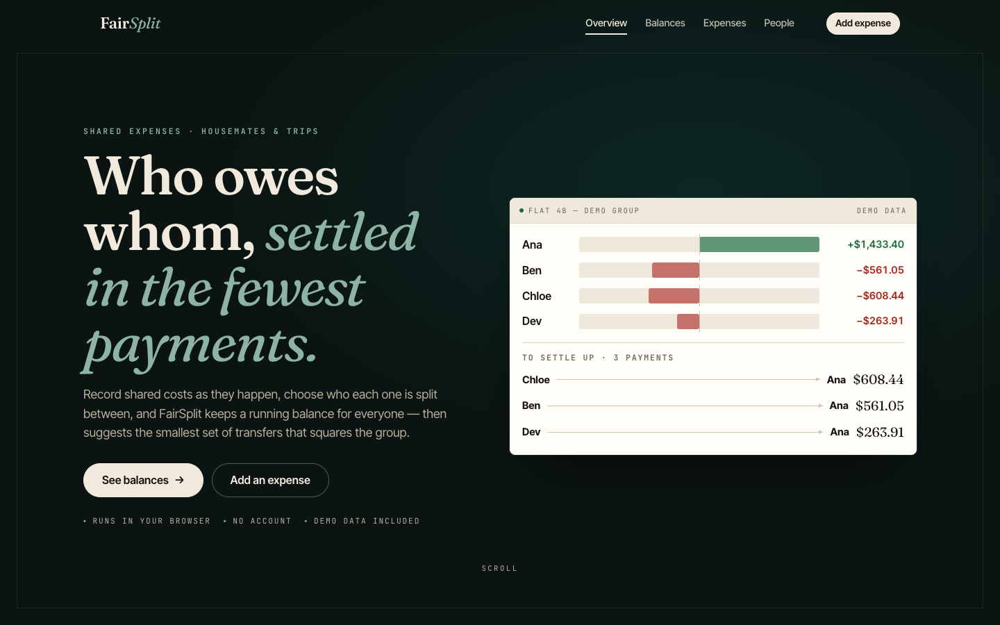
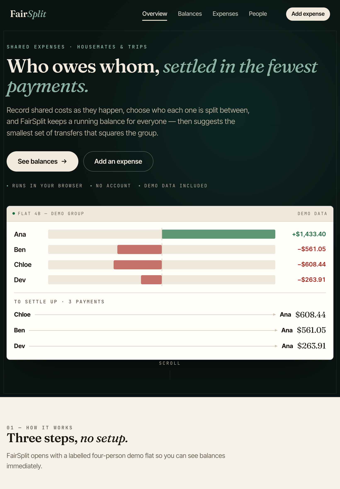
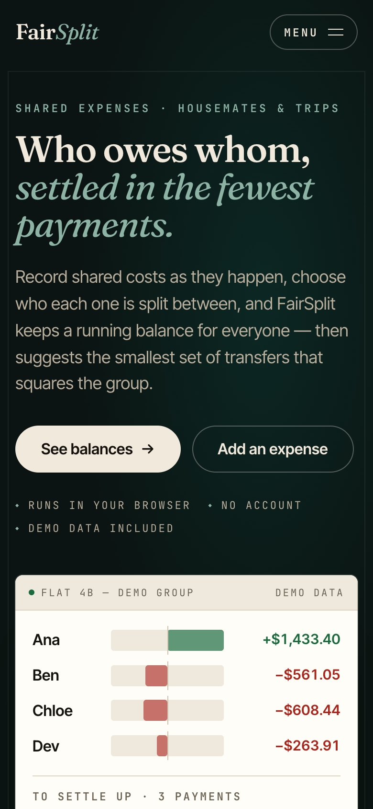
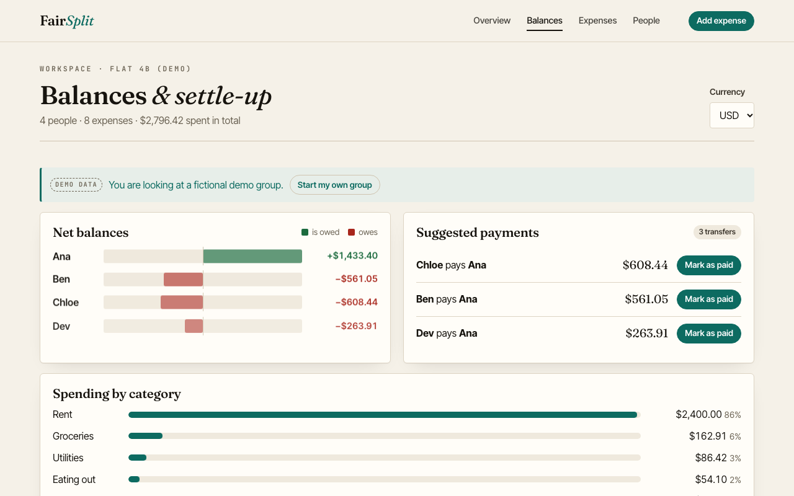
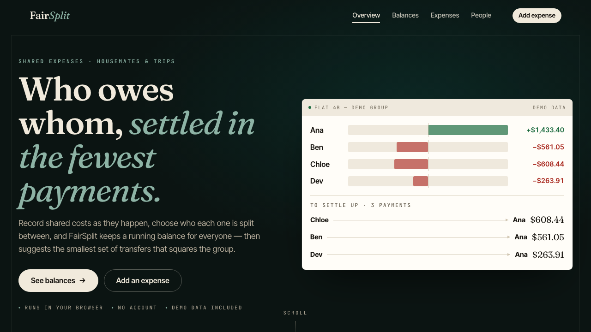
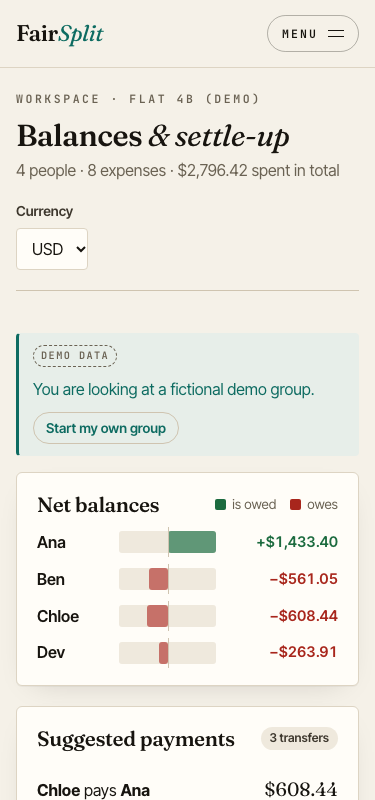

# FairSplit

<!-- screenshots:start -->
<p align="center">
  
</p>
<p align="center">
  
  &nbsp;&nbsp;
  
</p>
<p align="center"><sub>Mac (1440×900) · Tablet (820×1180) · Phone (390×844)</sub></p>
<!-- screenshots:end -->

Split shared expenses between housemates or a trip group. Record who paid and who shares each cost, see everyone's net balance, and settle up with the fewest possible payments.

**Live demo:** [https://kavishtolani.github.io/fairsplit/](https://kavishtolani.github.io/fairsplit/) — runs entirely in your browser; demo data is fictional and labelled.



| Landing | Mobile |
| --- | --- |
|  |  |

## Run it

```bash
npm install
npm run dev        # http://localhost:5107
npm test
npm run build
npm run test:e2e   # Playwright smoke test (npm run e2e:install once if Chromium is missing)
```

## Main workflow

1. Opens with a fictional, clearly labelled demo flat (4 people, 8 expenses incl. a large rent payment, a partial split and a long description, plus one recorded payment). **Start my own group** clears it.
2. **People** → add everyone (duplicate and empty names rejected). People who appear in expenses cannot be removed (error explains why).
3. **Expenses** → description, amount (accepts `12.50`, `12,50`, `1,234.56`), date, payer, category, and who it is split between. Each person's share previews live, including uneven cents.
4. **Balances** → diverging bar chart of net balances, suggested transfers with **Mark as paid** (undoable), spending by category with percentages, and the payment log.
5. The expense table filters by category and payer, sorts by date or amount, and paginates (6 per page).

## How the maths works

- All money is integer cents. Equal splits give leftover cents to the first participants so parts always sum to the total.
- Balance = paid − share of each expense, adjusted by recorded payments. Balances always sum to zero.
- Settle-up plan: repeatedly match the largest debtor with the largest creditor — at most *n − 1* transfers.

## Tests

- `src/lib/split.test.ts` — amount parsing, cent-exact splitting, balances, settlements, minimal plan, removed people, category totals, validation.
- `src/App.test.tsx` — demo state, people → expense (with validation) → balances → mark paid → “Everyone is square”, removal guard, filter + pagination.
- `e2e/smoke.spec.ts` — demo → own group → uneven 3-way split → reload → settle up, strict 375px checks.

## Limitations

- Equal splits only (no percentages, shares or exact amounts per person).
- One group and one currency at a time; changing currency relabels amounts, it does not convert them.
- Expenses cannot be edited in place (delete and re-add).
- No money movement or bank connection — “Mark as paid” is a record only.

## Future improvements

- Unequal splits (percent / shares / exact), multiple groups, CSV export.

## Licence

MIT — see [LICENSE](LICENSE).
